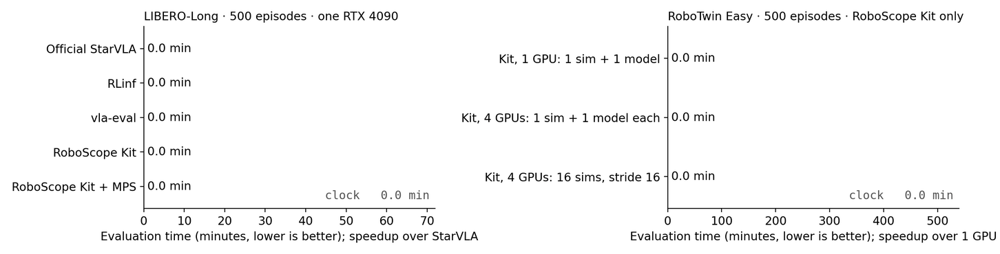
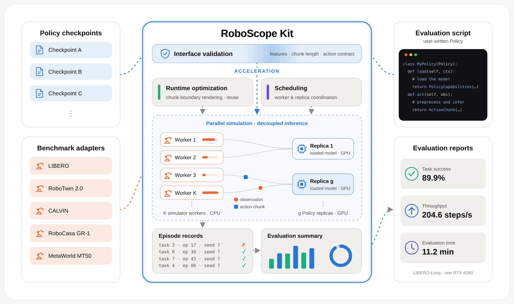

<h1 align="center">RoboScope Kit</h1>

<p align="center">
  <strong>Unified interfaces for fast and scalable embodied-AI evaluation</strong>
</p>

<p align="center">
  <a href="https://mint-sjtu.github.io/"></a>
  <a href="https://mint-sjtu.github.io/RoboScope-Kit/"></a>
  <a href="https://arxiv.org/abs/2611.03850"></a>
  <a href="https://pypi.org/project/roboscope-kit/"></a>
</p>

<p align="center">
  <a href="https://arxiv.org/abs/2611.03850">Paper</a> ·
  <a href="https://mint-sjtu.github.io/RoboScope-Kit/">Project page</a> ·
  <a href="packages/roboscope-kit/README.md">Package guide</a> ·
  <a href="packages/roboscope-kit/CHANGELOG.md">Changelog</a> ·
  <a href="CONTRIBUTING.md">Contributing</a>
</p>

<p align="center">
  
</p>

RoboScope Kit evaluates your model on standard robot simulation benchmarks. You wrap a model once in a Python
`Policy` class; the benchmark runtime drives the simulators, schedules the evaluation, and scores the results.
Each benchmark is wrapped once in an adapter around its own evaluator, so its rules and scoring stay unchanged.

## News

- 📄 **2026-11-24:** [Technical report v2](https://arxiv.org/abs/2611.03850v2) is out with new 4-GPU (**15.8×**) and 1-GPU (**13.2×**) RoboTwin Easy results.
- 🤖 **2026-11-19:** [RoboCasa365](packages/roboscope-kit/docs/robocasa365-protocol.md) is supported.
- 🤖 **2026-11-14:** [SimplerEnv](packages/roboscope-kit/SIMPLER_ENV_EVALUATION_PROTOCOL.md) is supported.
- 🤖 **2026-11-10:** [RLBench](packages/roboscope-kit/RLBENCH_EVALUATION_PROTOCOL.md) (the PerAct 18-task suite) is supported.
- 🤖 **2026-11-06:** [robomimic](packages/roboscope-kit/ROBOMIMIC_EVALUATION_PROTOCOL.md) and [LIBERO-Pro](packages/roboscope-kit/LIBERO_EVALUATION_PROTOCOL.md#11-libero-pro) are supported.
- 🎉 **2026-11-05:** RoboScope Kit is released! See the [technical report](https://arxiv.org/abs/2611.03850).
- 🤖 **2026-11-04:** [RoboDojo](benchmarks/robodojo/README.md) is supported.

## Highlights

- 🚀 **Faster evaluation:** with a StarVLA checkpoint, evaluation is **6.16×** faster than the official StarVLA
  evaluator on 500 LIBERO-Long episodes (one RTX 4090, CUDA MPS) and **15.8×** faster on the 5,000 RoboTwin Easy
  episodes (Kit and the official evaluator on the same four RTX PRO 5000 GPUs). See [Results](#results).
- 🧩 **One interface:** every supported benchmark runs through the same `Policy` API and sends its canonical
  observations unchanged.
- ⚙️ **Measured concurrency:** simulator Workers and Policy replicas run as separate pools. Autotune sizes both
  from real probe episodes, or you fix them with `--concurrency` and `--replicas`.
- 🌐 **Scale-out (Beta):** an evaluation can be sharded deterministically across GPU machines and merged
  afterwards.
- 📦 **Reproducible environments:** each benchmark's simulator is built from pinned sources by one script.
- ♻️ **Recoverable runs:** Work Items are claimed from a durable queue. A failed Worker's item returns to the
  queue, and a finished item is scored exactly once.

## Architecture



*The example metrics are for 500 LIBERO-Long episodes with 12 Workers and 3 replicas on one RTX 4090. See the
[interactive overview](https://mint-sjtu.github.io/RoboScope-Kit/#design).*

## Results

Headline speedups across benchmarks (evaluation time, excluding initialization, tuning, and cleanup). See
[full results](docs/results.md) for complete cross-system tables and per-benchmark breakdowns.

### LIBERO-Long

500 episodes on one 48 GiB RTX 4090 (`libero_10`), with equivalent success rates (89.9% vs. 90.2%):

| Model | Configuration | Baseline | Kit | Speedup | Details |
| --- | --- | ---: | ---: | ---: | :---: |
| [StarVLA (`Qwen2.5-VL`)](https://huggingface.co/StarVLA/Qwen2.5-VL-OFT-LIBERO-4in1) | `K12/G3` | 49.8 min (official) | **11.2 min** | **4.45×** (2.78× RLinf, 1.52× vla-eval) | [📊](docs/results.md#libero-long) |
| [StarVLA (`Qwen2.5-VL`)](https://huggingface.co/StarVLA/Qwen2.5-VL-OFT-LIBERO-4in1) | `K16/G4`, CUDA MPS | 49.8 min (official) | **8.1 min** | **6.16×** (3.85× RLinf, 2.10× vla-eval) | [📊](docs/results.md#libero-long) |

### RoboTwin Easy

Evaluation on `demo_clean` (50 tasks × 10 or 100 episodes), matching the official evaluator on every success outcome and terminal step:

| Model | Configuration | Baseline | Kit | Speedup | Details |
| --- | --- | ---: | ---: | ---: | :---: |
| [StarVLA (`Qwen3-VL`)](https://huggingface.co/StarVLA/Qwen3-VL-OFT-Robotwin2) | 500 ep., 1× RTX 4090, `K8/G1` | 7.0 h (official) | **31.9 min** | **13.2×** (7.3× vla-eval, 2.2× RLinf) | [📊](docs/results.md#robotwin-easy) |
| [StarVLA (`Qwen3-VL`)](https://huggingface.co/StarVLA/Qwen3-VL-OFT-Robotwin2) | 5,000 ep., 4× RTX PRO 5000, `K60/G8` | 17.5 h (official) | **66.4 min** | **15.8×** | [📊](docs/results.md#robotwin-easy) |

### RoboDojo

126 episodes (42 `arx_x5` tasks × 3 layouts) on one RTX 4090, matching upstream success rate (20.6%, McNemar *p* = 1.0):

| Model | Configuration | Baseline | Kit | Speedup | Details |
| --- | --- | ---: | ---: | ---: | :---: |
| [`Simate_beta`](https://huggingface.co/SIPAILab/sipai-robodojo-eval-ae) | `K2/G1` | 6.6 h (official) | **4.4 h** | **1.51×** | [📊](docs/results.md#robodojo) |

### RoboCasa365

250 episodes (`target50` × 5) on one RTX 4090, passing all native comparison checks:

| Model | Configuration | Baseline | Kit | Speedup | Details |
| --- | --- | ---: | ---: | ---: | :---: |
| [Diffusion Policy](https://huggingface.co/robocasa/robocasa365_checkpoints) | `K4/G2`, CUDA MPS | 163.5 min (Kit, unopt.) | **80.8 min** | **2.02×** (93.2 vs. 46.1 steps/s) | [📊](docs/results.md#robocasa365) |

### ManiSkill

1,100 episodes (11 official tasks) on one RTX 4090, matching all native records:

| Model | Configuration | Baseline | Kit | Speedup | Details |
| --- | --- | ---: | ---: | ---: | :---: |
| [Official PPO](https://huggingface.co/datasets/haosulab/ManiSkill_Demonstrations/tree/3558f72cf99d51d04a6ac4779e88b3da4bbf1628) | `K8/G1` (task-spread) | 7.1 min (Kit, `K1/G1`) | **3.0 min** | **2.33×** (182.7 s vs. 426.2 s) | [📊](docs/results.md#maniskill) |

## Supported benchmarks

| Benchmark | Suites | Contract |
| --- | --- | --- |
| [LIBERO](https://github.com/Lifelong-Robot-Learning/LIBERO) | `libero_spatial`, `libero_object`, `libero_goal`, `libero_10`, `libero_90` | [LIBERO protocol](packages/roboscope-kit/LIBERO_EVALUATION_PROTOCOL.md) |
| [LIBERO-Plus](https://github.com/sylvestf/LIBERO-plus) | `libero_spatial`, `libero_object`, `libero_goal`, `libero_10` | [LIBERO protocol](packages/roboscope-kit/LIBERO_EVALUATION_PROTOCOL.md) |
| [LIBERO-Pro](https://github.com/Zxy-MLlab/LIBERO-PRO) | `libero_{goal,spatial,10,object}_{object,swap,lan,task}` | [LIBERO protocol, section 11](packages/roboscope-kit/LIBERO_EVALUATION_PROTOCOL.md#11-libero-pro) |
| [RoboTwin](https://github.com/RoboTwin-Platform/RoboTwin) | `demo_clean`, `demo_randomized` | [Seed protocol](benchmarks/robotwin/SEED_PROTOCOL.md) |
| [RoboDojo](https://github.com/RoboDojo-Benchmark/RoboDojo) | `arx_x5`, `arx_x5_randomized` | [RoboDojo guide](benchmarks/robodojo/README.md) |
| [RoboCasa GR-1 Tabletop](https://github.com/robocasa/robocasa-gr1-tabletop-tasks) | `tabletop` | [Manifest](benchmarks/robocasa/benchmark-manifest.json) |
| [RoboCasa365](https://github.com/robocasa/robocasa) | `target50`, `atomic_seen`, `composite_seen`, `composite_unseen` | [Protocol and validation scope](packages/roboscope-kit/docs/robocasa365-protocol.md) |
| [CALVIN](https://github.com/mees/calvin) | `task_D_D`, `task_ABC_D`, `task_ABCD_D` | [CALVIN protocol](packages/roboscope-kit/CALVIN_EVALUATION_PROTOCOL.md) |
| [MetaWorld](https://github.com/Farama-Foundation/Metaworld) | `mt50` | [MetaWorld protocol](packages/roboscope-kit/METAWORLD_EVALUATION_PROTOCOL.md) |
| [RLBench](https://github.com/stepjam/RLBench) | `peract_18` | [RLBench protocol](packages/roboscope-kit/RLBENCH_EVALUATION_PROTOCOL.md) |
| [robomimic](https://github.com/ARISE-Initiative/robomimic) | `ph_low_dim` | [robomimic protocol](packages/roboscope-kit/ROBOMIMIC_EVALUATION_PROTOCOL.md) |
| [SimplerEnv](https://github.com/simpler-env/SimplerEnv) | `google_robot_visual_matching`, `google_robot_variant_aggregation`, `widowx_visual_matching` | [SimplerEnv protocol](packages/roboscope-kit/SIMPLER_ENV_EVALUATION_PROTOCOL.md) |

The simulators, datasets, and assets are not dependencies of the PyPI package; `build-runtime.sh` builds them
separately. Simulator builds, real episodes, and model loading need Linux x86_64, a GPU, and network access.

## Ready-made policies

Start from an existing `Policy` for these models and frameworks:

| Model / Framework | Benchmarks | Example |
| --- | --- | --- |
| [StarVLA](https://github.com/starVLA/starVLA) Compatible | LIBERO, LIBERO-Plus, LIBERO-Pro, RoboTwin, RoboCasa GR-1 Tabletop, CALVIN, MetaWorld | [`examples/starvla/`](examples/starvla/README.md) |
| [OpenVLA](https://github.com/openvla/openvla) | LIBERO | [`examples/openvla/`](examples/openvla/README.md) |
| [X-VLA](https://github.com/2toINF/X-VLA) | LIBERO, LIBERO-Plus, RoboTwin, CALVIN | [`examples/xvla/`](examples/xvla/README.md) |
| [XPolicyLab](https://github.com/XPolicyLab/XPolicyLab) Compatible | RoboDojo | [`examples/xpolicylab/`](examples/xpolicylab/README.md) |
| [PerAct](https://github.com/peract/peract) | RLBench | [`examples/peract/`](examples/peract/README.md) |
| [Official RoboCasa365 Diffusion Policy](https://github.com/robocasa-benchmark/diffusion_policy) | RoboCasa365 | [`examples/robocasa365_diffusion/`](examples/robocasa365_diffusion/README.md) |
| [robomimic model zoo](https://robomimic.github.io/docs/model_zoo/robomimic_v0.1.html) | robomimic | [`examples/robomimic/`](examples/robomimic/README.md) |
| [RT-1-X](https://github.com/google-deepmind/open_x_embodiment) | SimplerEnv | [`examples/rt1/`](examples/rt1/README.md) |

## Quick start

### 1. Install

Python 3.11 or newer is required.

```bash
python -m pip install roboscope-kit
```

### 2. Write a Policy

`load_model` stands for your own model code:

```python
import numpy as np

from roboscope_kit import ActionChunk, BenchmarkName, Policy, PolicyCapabilities, run


class UserPolicy(Policy):
    def load(self, context):
        self.model = load_model(context.checkpoint_path)
        return PolicyCapabilities(
            supported_benchmarks=(BenchmarkName.LIBERO,),
            required_features=("images.primary", "state.proprioception"),
            supported_suites={BenchmarkName.LIBERO: ("libero_10",)},
            supported_action_chunk_sizes=(1,),
        )

    def act(self, observation):
        return ActionChunk(np.asarray(self.model.predict(observation.features), dtype=np.float32))


if __name__ == "__main__":
    run(UserPolicy())
```

### 3. Tell the runtime how to start it

Save this as `roboscope-policy.json`:

```json
{
  "schema_version": 2,
  "command": ["/opt/my-policy/bin/python", "/opt/my-policy/user_policy.py"],
  "cwd": "/opt/my-policy"
}
```

### 4. Build the simulator and evaluate

From a checkout of this repository:

```bash
benchmarks/libero/build-runtime.sh /sim/libero

python -m roboscope_kit.runtime.benchmark \
    --benchmark libero --suite libero_10 --checkpoint-source /models/my-checkpoint \
    --benchmark-manifest /sim/libero/benchmark-manifest.json \
    --policy-config /path/to/roboscope-policy.json \
    --output-dir /runs/libero_10
```

Add `--quick-test` for a short real evaluation with one Worker and one Server. Results, progress, and logs are
written under `--output-dir`.
Use a new or empty output directory for each run, including `--self-test`. Only a directory containing
`errors.jsonl` alone can be retried in place; existing run artifacts are never resumed or overwritten.
Keep shell and scheduler logs outside the output directory.

The [package guide](packages/roboscope-kit/README.md) covers the rest: how evaluation works, automatic
tuning, writing a Policy, CUDA MPS, and cross-instance sharding.

## Repository layout

| Path | Contents |
| --- | --- |
| `packages/roboscope-kit/` | The `roboscope-kit` package: public `Policy` API, protocol client and server, benchmark runtime, and the evaluation protocol documents |
| `benchmarks/<benchmark>/` | For CALVIN, LIBERO, LIBERO-Plus, LIBERO-Pro, ManiSkill, MetaWorld, RLBench, RoboCasa GR-1 Tabletop, RoboCasa365, RoboDojo, RoboTwin, robomimic, and SimplerEnv: the `benchmark-manifest.json` and `build-runtime.sh`, which builds the pinned simulator environment; RoboTwin also has its launcher and seed-cache tooling |
| `examples/starvla/` | The StarVLA `Policy` and one demo per benchmark, including the configurations behind the RoboScope Kit technical report |
| `examples/openvla/` | An OpenVLA `Policy` example for the four fine-tuned LIBERO suites, with an official native runner and episode-by-episode comparison |
| `examples/xvla/` | An X-VLA `Policy` example: a stateful Policy serving several benchmarks |
| `examples/xpolicylab/` | An XPolicyLab `Policy` example: serves any XPolicyLab policy on RoboDojo, validated with Simate-beta |
| `examples/peract/` | A PerAct `Policy` example for RLBench, with PerAct's native `eval.py` runner and an episode-by-episode comparison |
| `examples/robocasa365_diffusion/` | A RoboCasa365 multi-task Diffusion Policy example for `pretrain_human300`, with a native rollout comparison |
| `examples/robomimic/` | A robomimic model-zoo `Policy` example: per-episode RNN and RNG state, with a native comparison script |
| `examples/maniskill/` | ManiSkill PPO and visual Policy examples, pinned checkpoint catalogs, and native comparisons |
| `examples/rt1/` | An RT-1-X `Policy` example for SimplerEnv, with a runner for SimplerEnv's official scripts and an episode-by-episode comparison |
| `ci/` | Build, compatibility, and PyPI release scripts used by GitHub Actions |

## Contributing

Contributions are very welcome! 🎉 Bug reports, documentation fixes, new `Policy` examples, new benchmarks, and
performance work all help, and questions are contributions too. Open an
[Issue](https://github.com/MINT-SJTU/RoboScope-Kit/issues) to report a bug or propose a change, and read
[`CONTRIBUTING.md`](CONTRIBUTING.md) for how to set up a checkout, run the checks, and what a pull request
needs. Performance pull requests need a same-machine A/B measurement.

## Citation

If you find RoboScope Kit helpful in your research, please consider citing our work:

```bibtex
@misc{wu2026roboscopekit,
  title         = {RoboScope Kit: Unified Interfaces for Fast and Scalable Embodied-AI Evaluation},
  author        = {Wu, Deng-Ke and Jin, Yifan and Yang, Yida and Qian, Lei and Zhou, Zhaoye and Zhang, Hongru and Ye, Kai and Hu, Shuyuan and Mao, Yiran and Ye, Zewei and Zhao, Bo},
  year          = {2026},
  eprint        = {2611.03850},
  archivePrefix = {arXiv},
  primaryClass  = {cs.RO}
}
```

## License

Copyright 2026 RoboScope Team. Licensed under the Apache License, Version 2.0. See [`LICENSE`](LICENSE).

## Community

Ask questions, share your results, and discuss new benchmarks in
[GitHub Discussions](https://github.com/MINT-SJTU/RoboScope-Kit/discussions). Report bugs as
[Issues](https://github.com/MINT-SJTU/RoboScope-Kit/issues).

WeChat users can also scan the QR code to join the RoboScope Kit group (the invitation is valid before
December 1, 2026):


