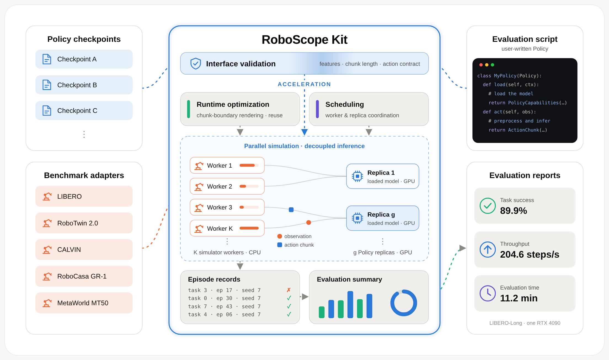

<h1 align="center">RoboScope Kit</h1>

<p align="center">
  <strong>Unified interfaces for fast and scalable embodied-AI evaluation</strong>
</p>

<p align="center">
  <a href="https://mint-sjtu.github.io/"></a>
  <a href="https://arxiv.org/abs/2611.03850"></a>
  <a href="https://pypi.org/project/roboscope-kit/"></a>
</p>

<p align="center">
  <a href="https://arxiv.org/abs/2611.03850">Paper</a> ·
  <a href="https://mint-sjtu.github.io/RoboScope-Kit/">Project page</a> ·
  <a href="packages/roboscope-kit/README.md">Package guide</a> ·
  <a href="packages/roboscope-kit/CHANGELOG.md">Changelog</a> ·
  <a href="#contributing">Contributing</a>
</p>

RoboScope Kit evaluates your model on standard robot simulation benchmarks. You wrap a model once in a Python
`Policy` class; the benchmark runtime drives the simulators, schedules the evaluation, and scores the results.
Each benchmark is wrapped once in an adapter around its own evaluator, so its rules and scoring stay unchanged.

## Highlights

- 🚀 **Faster evaluation:** on 500 episodes with a StarVLA checkpoint, evaluation is **6.16×**
  faster than the official StarVLA evaluator on LIBERO-Long (one RTX 4090, CUDA MPS) and **25.04×** faster on
  RoboTwin Easy (four RTX 4090s vs. a one-GPU baseline). See [Results](#results).
- 🧩 **One interface:** every supported benchmark runs through the same `Policy` API and sends its canonical
  observations unchanged.
- ⚙️ **Measured concurrency:** simulator Workers and Policy replicas run as separate pools. Autotune sizes both
  from real probe episodes, or you fix them with `--concurrency` and `--replicas`.
- 🌐 **Scale-out (Beta):** an evaluation can be sharded deterministically across GPU machines and merged
  afterwards.
- 📦 **Reproducible environments:** each benchmark's simulator is built from pinned sources by one script.
- ♻️ **Recoverable runs:** Work Items are claimed from a durable queue. A failed Worker's item returns to the
  queue, and a finished item is scored exactly once.

## Architecture



*The example metrics are for 500 LIBERO-Long episodes with 12 Workers and 3 replicas on one RTX 4090. See the
[interactive overview](https://mint-sjtu.github.io/RoboScope-Kit/#design).*

## Results

From the [technical report](https://arxiv.org/abs/2611.03850), each run covering 500 episodes with a StarVLA
checkpoint. Evaluation time excludes initialization, concurrency search or offline tuning, and cleanup.
LIBERO-Long, on one 48 GiB RTX 4090, with success rates equivalent to the official evaluation's:

| Configuration | vs. official StarVLA | vs. RLinf | vs. vla-eval |
| --- | ---: | ---: | ---: |
| 12 Workers, 3 replicas | **4.45×** | **2.78×** | **1.52×** |
| 16 Workers, 4 replicas, CUDA MPS | **6.16×** | **3.85×** | **2.10×** |

RoboTwin Easy, on four GPUs with chunk-boundary observation, takes 14.4 minutes instead of 359.7 with one
simulator and one model on one GPU (**25.04×**), with identical success outcomes and terminal steps.

## Supported benchmarks

| Benchmark | Suites | Contract |
| --- | --- | --- |
| [LIBERO](https://github.com/Lifelong-Robot-Learning/LIBERO) | `libero_spatial`, `libero_object`, `libero_goal`, `libero_10`, `libero_90` | [LIBERO protocol](packages/roboscope-kit/LIBERO_EVALUATION_PROTOCOL.md) |
| [LIBERO-Plus](https://github.com/sylvestf/LIBERO-plus) | `libero_spatial`, `libero_object`, `libero_goal`, `libero_10` | [LIBERO protocol](packages/roboscope-kit/LIBERO_EVALUATION_PROTOCOL.md) |
| [RoboTwin](https://github.com/RoboTwin-Platform/RoboTwin) | `demo_clean`, `demo_randomized` | [Seed protocol](benchmarks/robotwin/SEED_PROTOCOL.md) |
| [RoboDojo](https://github.com/RoboDojo-Benchmark/RoboDojo) | `arx_x5`, `arx_x5_randomized` | [RoboDojo guide](benchmarks/robodojo/README.md) |
| [RoboCasa](https://github.com/robocasa/robocasa-gr1-tabletop-tasks) | `tabletop` | [Manifest](benchmarks/robocasa/benchmark-manifest.json) |
| [CALVIN](https://github.com/mees/calvin) | `task_D_D`, `task_ABC_D`, `task_ABCD_D` | [CALVIN protocol](packages/roboscope-kit/CALVIN_EVALUATION_PROTOCOL.md) |
| MetaWorld | `mt50` | [MetaWorld protocol](packages/roboscope-kit/METAWORLD_EVALUATION_PROTOCOL.md) |

The simulators, datasets, and assets are not dependencies of the PyPI package; `build-runtime.sh` builds them
separately. Simulator builds, real episodes, and model loading need Linux x86_64, a GPU, and network access.

## Quick start

### 1. Install

Python 3.11 or newer is required.

```bash
python -m pip install roboscope-kit
```

### 2. Write a Policy

`load_model` stands for your own model code:

```python
import numpy as np

from roboscope_kit import ActionChunk, BenchmarkName, Policy, PolicyCapabilities, run


class UserPolicy(Policy):
    def load(self, context):
        self.model = load_model(context.checkpoint_path)
        return PolicyCapabilities(
            supported_benchmarks=(BenchmarkName.LIBERO,),
            required_features=("images.primary", "state.proprioception"),
            supported_suites={BenchmarkName.LIBERO: ("libero_10",)},
            supported_action_chunk_sizes=(1,),
        )

    def act(self, observation):
        return ActionChunk(np.asarray(self.model.predict(observation.features), dtype=np.float32))


if __name__ == "__main__":
    run(UserPolicy())
```

### 3. Tell the runtime how to start it

Save this as `roboscope-policy.json`:

```json
{
  "schema_version": 2,
  "command": ["/opt/my-policy/bin/python", "/opt/my-policy/user_policy.py"],
  "cwd": "/opt/my-policy"
}
```

### 4. Build the simulator and evaluate

From a checkout of this repository:

```bash
benchmarks/libero/build-runtime.sh /sim/libero

python -m roboscope_kit.runtime.benchmark \
    --benchmark libero --suite libero_10 --checkpoint-source /models/my-checkpoint \
    --benchmark-manifest /sim/libero/benchmark-manifest.json \
    --policy-config /path/to/roboscope-policy.json \
    --output-dir /runs/libero_10
```

Add `--quick-test` for a short real evaluation with one Worker and one Server. Results, progress, and logs are
written under `--output-dir`.

The [package guide](packages/roboscope-kit/README.md) covers the rest: how evaluation works, automatic
tuning, writing a Policy, CUDA MPS, and cross-instance sharding.

## Repository layout

| Path | Contents |
| --- | --- |
| `packages/roboscope-kit/` | The `roboscope-kit` package: public `Policy` API, protocol client and server, benchmark runtime, and the evaluation protocol documents |
| `benchmarks/<benchmark>/` | For CALVIN, LIBERO, LIBERO-Plus, MetaWorld, RoboCasa, RoboDojo, and RoboTwin: the `benchmark-manifest.json` and `build-runtime.sh`, which builds the pinned simulator environment; RoboTwin also has its launcher and seed-cache tooling |
| `examples/starvla/` | The StarVLA `Policy` and one demo per benchmark, including the configurations behind the RoboScope Kit technical report |
| `examples/xvla/` | An X-VLA `Policy` example: a stateful Policy serving several benchmarks |
| `examples/xpolicylab/` | An XPolicyLab `Policy` example: serves any XPolicyLab policy on RoboDojo, validated with Simate-beta |
| `ci/` | Build, compatibility, and PyPI release scripts used by GitHub Actions |

## Development

Install from source and run the checks:

```bash
cd packages/roboscope-kit
python -m pip install . pytest ruff matplotlib
PYTHONPATH=src:../.. python -m pytest tests -q
python -m ruff check src tests ../../benchmarks/robotwin
```

To build a benchmark's simulator environment and check it against the kit:

```bash
benchmarks/libero/build-runtime.sh /sim/libero
python -m roboscope_kit.runtime.benchmark --benchmark libero --self-test \
    --benchmark-manifest /sim/libero/benchmark-manifest.json --output-dir /tmp/libero-self-test
```

To reproduce the CI compatibility check on the built wheel and sdist, run these with the interpreter you
want to test:

```bash
python -m pip install build twine
bash ci/build-sdk.sh
bash ci/check-sdk.sh
```

Supported Python versions follow the official CPython release lifecycle, with Python 3.11 as the minimum.
The list lives in `packages/roboscope-kit/pyproject.toml` under `tool.roboscope.python-support`; CI reads it
to build its test matrix and fails when it drifts from the official lifecycle.

## Releases

Releases are automatic. GitHub Actions (`.github/workflows/sdk-compatibility.yml`) is the only publisher.

1. Bump the version in `packages/roboscope-kit/pyproject.toml` and `uv.lock`, and add a `CHANGELOG.md`
   entry headed `## <version> - <YYYY-MM-DD>`.
2. Merge the change to `main`.
3. CI builds the wheel and sdist once, tests them on every supported Python version, uploads them to PyPI
   with the `PYPI_API_TOKEN` repository secret, then checks the published hashes and a clean install.

A version that is already on PyPI is never uploaded again; CI only re-checks the install. Pull requests run
the tests but never publish. To retry a failed upload, run the `SDK compatibility` workflow manually on
`main`.

## Contributing

Contributions are very welcome! 🎉 Bug reports, documentation fixes, new `Policy` examples, new benchmarks, and
performance work all help, and questions are contributions too. If you are unsure where to start, open an
[Issue](https://github.com/MINT-SJTU/RoboScope-Kit/issues) or ask in the [community](#community).

### How to contribute

- **Report a bug** with the command you ran, the `roboscope-kit` version, the benchmark and suite, what you
  expected, and the relevant logs from `--output-dir`.
- **Propose larger work first.** For a new benchmark, a new feature, or a design change, open an Issue so we
  can agree on the approach before you invest the time.
- **Open a pull request** from a branch of your fork. Keep it to one problem, describe what changed, why, and
  how you checked it, and run the checks in [Development](#development) before you push.

[`AGENTS.md`](AGENTS.md) has the full repository rules. The ones contributors most often need:

- **Titles** follow `type(scope): description` ([Conventional Commits](https://www.conventionalcommits.org/en/v1.0.0/)),
  in English. The type is one of `feat`, `fix`, `perf`, `docs`, `refactor`, `test`, `build`, `ci`, or
  `chore`; the scope is a benchmark or component, such as `robodojo`, `libero`, `sdk`, or `autotune`, or
  `repo` for repository-wide work. For example: `perf(robodojo): improve RoboDojo evaluation throughput`.
- **Code changes bump the version** in `pyproject.toml` and `uv.lock` and add a `CHANGELOG.md` entry, as
  described in [Releases](#releases). Documentation-only changes need no bump.
- **Simulator environments change only through `benchmarks/<benchmark>/build-runtime.sh`** and its pin
  files, so a clean build reproduces them. Do not patch an installed environment by hand.
- **Benchmark rules and scoring stay unchanged.** Keep each manifest consistent with its build script, and do
  not change frozen protocol values (such as the RoboTwin seed protocol) without regenerating what depends on
  them.
- **Keep the documentation consistent** when user-facing evaluation behavior changes: this README, the
  package README, the protocol documents, and the example READMEs.

### Coding agents are welcome

You may use coding agents and AI assistants (Claude Code, Codex, Cursor, Copilot, and others) to write code,
tests, or documentation; point them to [`AGENTS.md`](AGENTS.md) for the repository rules. You remain the
author of what you submit: read and understand the whole change, run the checks yourself, be ready to explain
it in review, and make sure every number and test result in the description comes from a run that actually
happened.

### Performance changes need experimental evidence

Speed is a core promise of RoboScope Kit, and performance work is especially welcome. Because performance is
easy to mismeasure, a `perf` pull request, or any change claiming faster or lighter evaluation, must include
experimental evidence; a claim without measurements cannot be merged. Please provide:

1. **A same-machine A/B comparison:** the baseline commit and your change, run back to back on the same
   machine with the same benchmark, suite, checkpoint, episode count, and Worker, replica, and CUDA MPS
   settings. Numbers from different machines or days are not comparable.
2. **The setup and exact commands:** CPU, GPU model and count, driver and CUDA version, and the commit of
   each side, so a reviewer can reproduce the runs.
3. **The results:** evaluation wall-clock time (excluding initialization, concurrency search, and cleanup,
   unless the change targets them), steps/s or episodes/s, and any resource metric you claim to improve.
   Repeat each side when you can (three runs is a good default) and report the median and spread.
4. **Evidence that the evaluation is unchanged:** success outcomes that match the baseline (per-episode
   outcomes and terminal steps where the benchmark is deterministic, otherwise equivalent success rates),
   with every episode finished exactly once and no missing or duplicate records.
5. **The raw data:** run summaries and logs, attached or linked, or a short report like the
   [RoboTwin performance report](benchmarks/robotwin/PERFORMANCE_REPORT_2026-07-22.md).

Without the hardware for a full run, open a draft pull request with what you could measure (a `--quick-test`
run or a profile, say) and tell us; we are glad to help. Negative results are useful too: an attempt that did
not help, with its measurements, saves others from repeating it.

By contributing, you agree that your contributions are licensed under the project's
[Apache License 2.0](LICENSE).

## Citation

If you find RoboScope Kit helpful in your research, please consider citing our work:

```bibtex
@misc{wu2026roboscopekit,
  title         = {RoboScope Kit: Unified Interfaces for Fast and Scalable Embodied-AI Evaluation},
  author        = {Wu, Deng-Ke and Jin, Yifan and Yang, Yida and Qian, Lei and Zhou, Zhaoye and Zhang, Hongru and Ye, Kai and Hu, Shuyuan and Mao, Yiran and Ye, Zewei and Zhao, Bo},
  year          = {2026},
  eprint        = {2611.03850},
  archivePrefix = {arXiv},
  primaryClass  = {cs.RO}
}
```

## License

Copyright 2026 RoboScope Team. Licensed under the Apache License, Version 2.0. See [`LICENSE`](LICENSE).

## Community

Scan the QR code with WeChat to join the RoboScope Kit community.


The invitation is valid before November 12, 2026.
